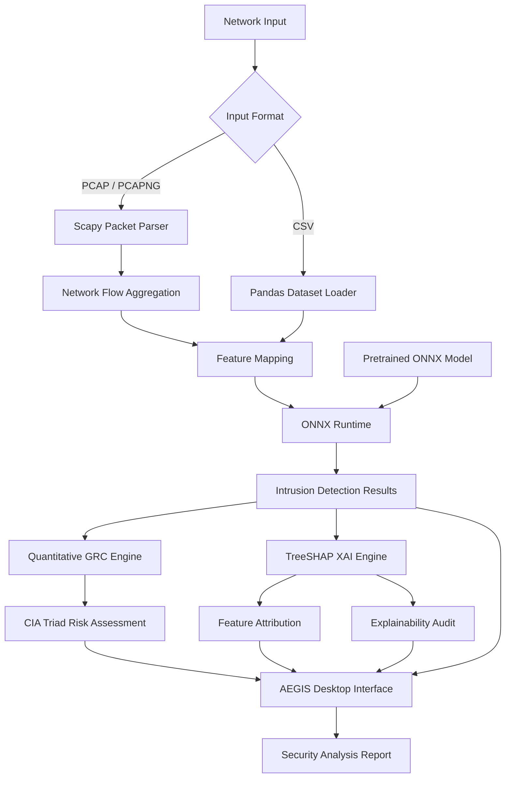

# AEGIS

**An explainable AI-powered network intrusion detection and quantitative GRC analysis platform for Internet of Medical Things (IoMT) environments.**

`AEGIS` is a standalone native desktop application and cybersecurity research prototype designed for network intrusion detection, quantitative risk assessment, and explainable AI auditing in IoMT environments. It analyzes raw network traffic captures (`.pcap`, `.pcapng`) and structured telemetry datasets (`.csv`), performs machine learning inference through ONNX Runtime, and translates detection results into measurable security risks using the Confidentiality, Integrity, and Availability (CIA) triad.

AEGIS integrates network traffic analysis, machine learning, Governance, Risk, and Compliance (GRC), and Explainable Artificial Intelligence (XAI) into a single desktop application. It runs natively on macOS and Windows, without requiring a browser or local web server.

## Why

Traditional intrusion detection systems primarily focus on classifying network activity as benign or malicious. However, identifying a threat is only part of the security analysis process, particularly in critical environments such as the Internet of Medical Things.

A suspicious network flow can have different implications depending on the affected infrastructure, the sensitivity of the transmitted information, and the potential impact on system availability or integrity.

`AEGIS` explores a broader approach by connecting three complementary security dimensions:

- **Detection:** Identifies potentially malicious network activity through machine learning and network traffic analysis.
- **Risk Assessment:** Converts detection results into quantitative risk measurements using GRC methodologies and the CIA triad.
- **Explainability:** Uses TreeSHAP to identify the features contributing to individual model predictions, providing an interpretable audit trail.

The objective is to move beyond conventional threat classification and provide a more transparent, risk-oriented security analysis workflow for IoMT infrastructures.

## Architecture



## Key Features

### Native Desktop Architecture

- Standalone desktop application for macOS and Windows.
- No browser or local web server required.
- No background application ports or web-based dependencies.
- CustomTkinter interface with native window rendering.
- Direct in-memory machine learning inference through ONNX Runtime.

### Network Intrusion Detection

- Supports raw packet captures in `.pcap` and `.pcapng` formats.
- Supports structured network telemetry datasets in `.csv` format.
- Scapy-based packet parsing and network flow aggregation.
- Feature mapping and alignment for machine learning inference.
- Optimized ONNX classification model for CPU-based execution.

### Quantitative GRC Risk Analysis

- Converts intrusion detection results into quantitative security risk scores.
- Evaluates potential impacts across the Confidentiality, Integrity, and Availability (CIA) triad.
- Provides a risk-oriented perspective beyond conventional threat classification.
- Designed for security analysis in critical medical and IoMT infrastructures.

### Explainable AI and Compliance Auditing

- Uses TreeSHAP to explain individual machine learning predictions.
- Identifies the features contributing to model classification decisions.
- Generates local feature attribution information for security auditing.
- Integrates explainability with quantitative risk analysis.
- Supports research into transparent cybersecurity systems and compliance-oriented auditing, including regulatory contexts such as LGPD and HIPAA.

### Security Operations Interface

- Piano-black operator interface designed for security analysis workflows.
- Minimal dark visual language focused on telemetry and threat information.
- Integrated detection, GRC, and explainability views.
- Researcher profile accordion integrated into the application.
- Centralized interface for network analysis and security reporting.

## Technology Stack

| Component | Technology |
|-----------|------------|
| Desktop UI | CustomTkinter |
| Programming Language | Python |
| Machine Learning Runtime | ONNX Runtime |
| Machine Learning | Scikit-learn |
| Explainable AI | TreeSHAP / SHAP |
| Network Processing | Scapy |
| Data Processing | Pandas |
| Model Format | ONNX |
| Application Packaging | PyInstaller |
| Project Configuration | uv / pyproject.toml |

## Project Structure

```text
AEGIS/
├── assets/
│   ├── aegisicon.icns
│   └── aegisicon.png
├── backend/
│   ├── benchmark.py
│   ├── grc.py
│   ├── main.py
│   ├── model.py
│   ├── parser.py
│   └── xai.py
├── data/
│   └── aegis_dataset_sample.csv
├── frontend/
│   └── app.py
├── models/
│   └── aegis_ciciomt_model.onnx
├── testbed/
│   └── topology.py
├── .gitignore
├── aegis.spec
├── pyproject.toml
├── README.md
└── uv.lock
```

### Backend

- `benchmark.py` — Model benchmarking and evaluation utilities.
- `grc.py` — Quantitative GRC risk calculation and CIA triad scoring.
- `main.py` — Core application backend and analysis orchestration.
- `model.py` — Feature mapping and machine learning inference pipeline using ONNX Runtime.
- `parser.py` — Scapy-based packet parsing and network flow aggregation.
- `xai.py` — TreeSHAP feature attribution and explainability audit generation.

### Frontend

- `app.py` — CustomTkinter native desktop interface and application controller.

### Data

- `aegis_dataset_sample.csv` — Sample network telemetry dataset for testing and analysis.

### Models

- `aegis_ciciomt_model.onnx` — Optimized ONNX classification model used for machine learning inference.

### Assets

- `aegisicon.png` — Source branding asset.
- `aegisicon.icns` — Native macOS application icon.

### Testbed

- `topology.py` — Network testbed topology configuration and experimentation utilities.

### Project Configuration

- `aegis.spec` — PyInstaller application packaging configuration.
- `pyproject.toml` — Python project metadata and dependency configuration.
- `uv.lock` — Locked dependency versions for reproducible environments.

## Running from Source

### 1. Install Dependencies

AEGIS uses Python and the dependencies defined in its project configuration.

Using pip:

```bash
pip install customtkinter pandas scikit-learn onnxruntime shap scapy pyinstaller
```

### 2. Run the Application

Start the native desktop interface:

```bash
python3 frontend/app.py
```

The application should open as a standalone desktop window.

## Building the Application

AEGIS uses PyInstaller to package the application into a standalone executable.

### 1. Clean Previous Builds

```bash
rm -rf dist build
```

### 2. Build Using the Spec File

```bash
pyinstaller aegis.spec --clean
```

### 3. Locate the Application

The generated application will be available inside:

```text
dist/
```

On macOS, the output is packaged as a native `.app` application. On Windows, PyInstaller generates the corresponding executable distribution.

## Research Context

AEGIS is part of ongoing research into machine learning applications for cybersecurity in Internet of Medical Things (IoMT) environments.

The project explores the integration of:

- Network intrusion detection systems (NIDS).
- Machine learning-based threat classification.
- Network traffic analysis and feature extraction.
- Quantitative Governance, Risk, and Compliance (GRC).
- Confidentiality, Integrity, and Availability (CIA) impact assessment.
- Explainable Artificial Intelligence (XAI).
- TreeSHAP-based feature attribution.
- Compliance-oriented security auditing.
- IoMT infrastructure protection.

The research objective is to establish a unified security analysis workflow connecting **threat detection, quantitative risk assessment, and explainable machine learning**.

Rather than treating intrusion detection as an isolated classification task, AEGIS explores how machine learning predictions can be translated into interpretable security information and measurable risk indicators.

## Limitations

- Model predictions depend on the quality and feature compatibility of the input datasets.
- The classification model is limited to the traffic patterns and classes represented in its training data.
- Quantitative GRC scores are analytical indicators and should not be interpreted as definitive measurements of real-world organizational risk.
- SHAP explanations describe model behavior and feature contributions; they do not establish causality.
- The application is a research prototype and has not been established as a certified medical-device security solution.
- Detection results should complement, rather than replace, professional security assessments and incident response procedures.

## Author

**Ygor Gesteira**

Master's Researcher at **Instituto Federal da Paraíba (IFPB)**

Research focus: Machine learning, Explainable Artificial Intelligence, quantitative cybersecurity risk assessment, and intrusion detection in Internet of Medical Things (IoMT) environments.

## License

MIT
